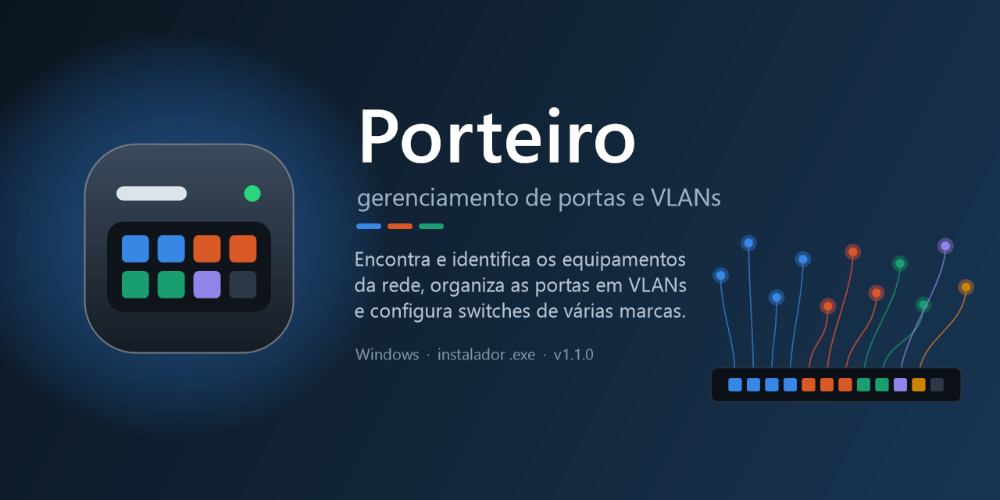
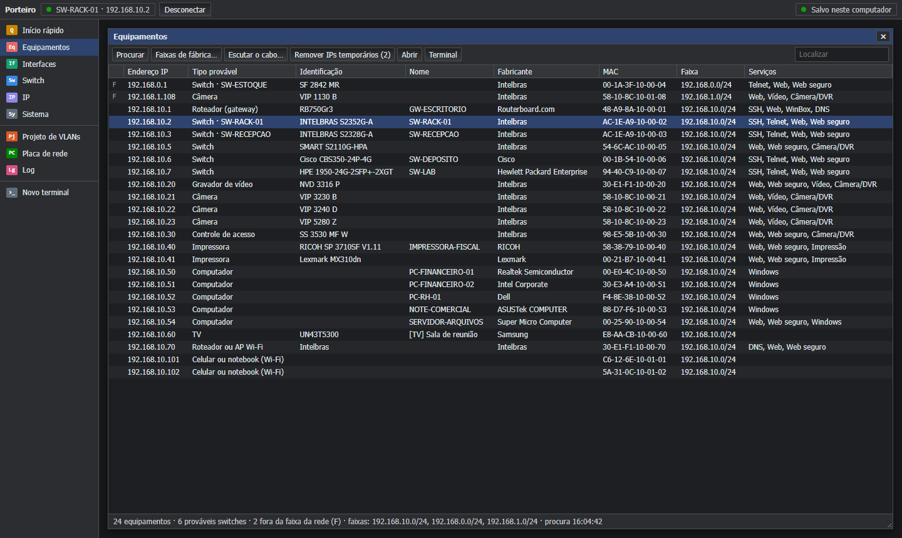
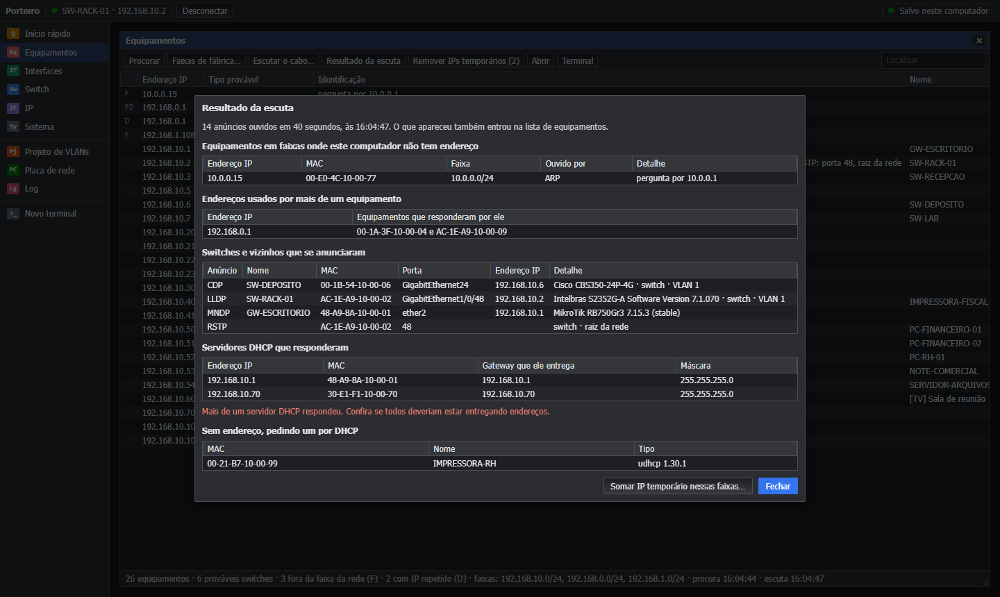
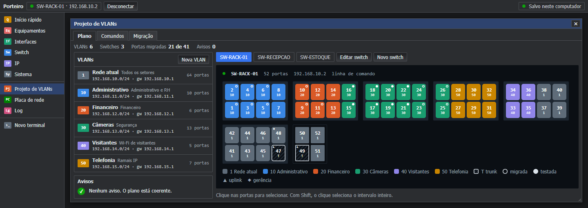
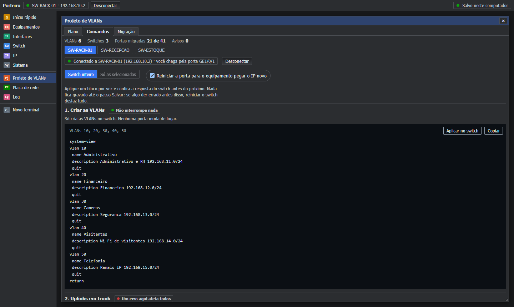
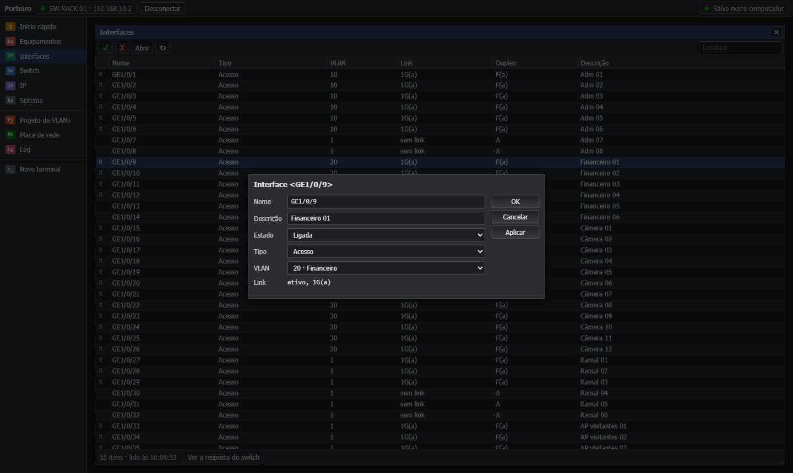
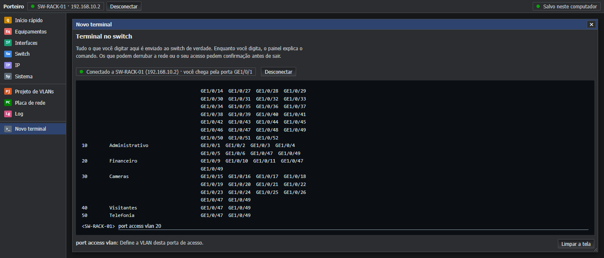
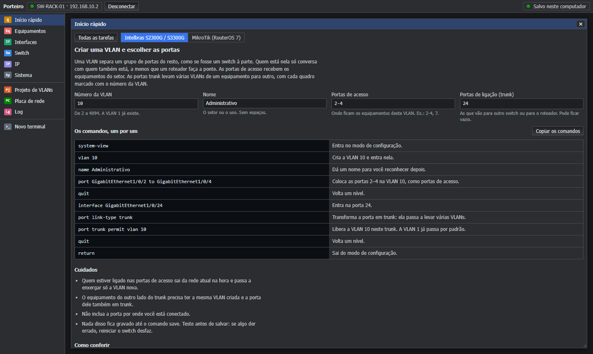
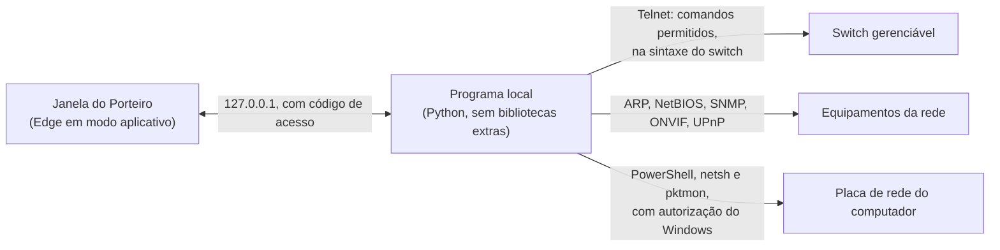

<p align="center">
  
</p>

<p align="center">
  <a href="https://github.com/yanbnt/porteiro/releases/latest"></a>
  
  
  
</p>

<p align="center">
  <a href="https://github.com/yanbnt/porteiro/releases/latest"><b>⬇ Baixar o instalador</b></a>
  &nbsp;·&nbsp; <a href="#telas">Telas</a>
  &nbsp;·&nbsp; <a href="#marcas-e-modelos">Marcas</a>
  &nbsp;·&nbsp; <a href="#instalar">Instalar</a>
  &nbsp;·&nbsp; <a href="#segurança">Segurança</a>
  &nbsp;·&nbsp; <a href="#perguntas-frequentes">Perguntas</a>
</p>

# Porteiro

**Gerenciamento de portas, VLANs e switches** para Windows, no estilo do WinBox. Feito para quem precisa organizar a rede de uma empresa em VLANs **sem parar o trabalho de ninguém**, com switches de marcas e modelos diferentes. Até a versão 1.0.0 se chamava Painel de VLANs.

Organizar a rede por setor (administrativo, financeiro, câmeras, visitantes) costuma esbarrar em três problemas:

1. Ninguém sabe direito o que está ligado em cada porta.
2. Há switches esquecidos com o IP de fábrica, fora da faixa da rede.
3. Um comando errado no switch derruba quem está trabalhando.

O Porteiro resolve os três:

- **Encontra e identifica sozinho** cada equipamento da rede, de qualquer marca: tipo, modelo, nome e fabricante, até os que estão com IP de fábrica.
- **Monta o plano de VLANs** por switch e por porta, num desenho do switch com as portas coloridas pela VLAN.
- **Gera os comandos na sintaxe da CLI do switch e aplica** um bloco por vez, com proteções contra derrubar a rede e contra cortar a conexão do próprio computador.
- **Ensina enquanto faz:** cada comando vem explicado, e há tarefas guiadas e um terminal de treino.

Tudo roda no próprio computador. Nada vai para a internet.

## Telas

> As fotos usam o [modo demonstração](#experimentar-sem-rede), com uma rede fictícia de escritório.

### Equipamentos: a rede inteira, identificada sozinha

<p align="center"></p>

A procura passa por todas as faixas em que o computador tem endereço e pergunta a cada equipamento quem ele é, sem usar senha nenhuma. Em cerca de 25 segundos, uma rede de cem equipamentos aparece com tipo, modelo, nome e fabricante.

| Pergunta feita ao equipamento | O que ela revela |
|---|---|
| Tela web do equipamento | Título da página e modelo, quando a página informa |
| NetBIOS | Nome dos computadores e o grupo de trabalho |
| SNMP, comunidade `public` | Descrição e nome de switches gerenciáveis e impressoras de qualquer marca |
| Descoberta da linha Intelbras/Dahua | Modelo de câmeras, gravadores, controles de acesso e switches smart |
| ONVIF | Modelo de câmeras de outras marcas |
| UPnP | Nome, marca e modelo de TVs e roteadores |
| Começo do MAC, pela lista pública da IEEE | Fabricante de qualquer equipamento |

- **Faixas de fábrica:** soma endereços temporários ao computador (192.168.0.x, 192.168.1.x, 192.168.88.x e outras) para enxergar quem ainda está com o IP de fábrica. Esses equipamentos aparecem marcados com **F**.
- **Switches do projeto:** quem está cadastrado no projeto aparece com o nome dado no plano, reconhecido pelo MAC da etiqueta.
- **Abrir e Terminal:** abrem a tela web ou o terminal do equipamento selecionado.

### Escuta do cabo: o que nenhuma procura alcança

<p align="center"></p>

Alguns equipamentos ficam invisíveis para a procura: os que estão numa faixa de IP que ninguém conhece, ou dois aparelhos com o mesmo IP. A escuta grava, por 40 segundos a 2 minutos e meio, só os anúncios que passam pelo cabo, e mostra:

- equipamentos em faixas onde o computador não tem endereço;
- **endereços usados por mais de um equipamento**, marcados com **D** na lista;
- switches e roteadores que se anunciam (LLDP, CDP da Cisco, MNDP da MikroTik e spanning tree), com nome, porta e qual deles é a raiz da rede;
- servidores DHCP que responderam, com aviso quando há mais de um;
- equipamentos sem endereço, pedindo um por DHCP.

A escuta usa o capturador que já vem no Windows (`pktmon`), grava só anúncios (nunca o tráfego normal) e apaga a gravação depois de ler.

### Projeto de VLANs

<p align="center"></p>

- Cada VLAN tem número, nome, setor, faixa, gateway e onde fica o DHCP.
- Cada switch aparece desenhado como é, com as portas na cor da VLAN. Clique numa porta, ou num intervalo com Shift, para mudar VLAN, tipo (acesso ou trunk) e o que está ligado nela.
- As portas ficam marcadas como pendente, migrada ou testada, e o uplink e a porta de gerência ganham símbolos próprios.
- **Avisos** apontam o que não fecha antes de ir para o switch, por exemplo: uma VLAN que não passa por nenhum trunk e fica presa no switch, a porta de gerência indo para outra VLAN, gateway fora da sub-rede, sub-redes que se sobrepõem e dois switches com o mesmo IP de gerência.
- A aba **Migração** traz o roteiro em ordem segura: backup, levantamento das portas, gateway e DHCP de cada VLAN, criar as VLANs, uplinks em trunk, piloto, migração setor por setor, equipamentos de IP fixo e bloqueios entre VLANs.

### Comandos e aplicação no switch

<p align="center"></p>

Os comandos saem na sintaxe da CLI do switch, em blocos, na ordem em que devem ser aplicados, cada um com o risco escrito ao lado ("Não interrompe nada", "Um erro aqui afeta todos"). Dá para copiar e colar no PuTTY ou aplicar direto:

- só passam comandos de uma lista permitida;
- o envio para no primeiro erro e mostra a resposta do switch;
- o Porteiro recusa o bloco que cortaria a porta por onde o próprio computador chega ao switch;
- nada fica gravado no switch até o passo **Salvar**: se algo der errado antes, reiniciar o switch desfaz tudo.

### Interfaces e listas ao vivo

<p align="center"></p>

Com o switch conectado, as janelas **Interfaces**, **Switch** (VLANs e hosts), **IP** (endereços, ARP e rotas) e **Sistema** mostram o que o próprio switch responde. Dois cliques numa porta abrem as propriedades, com OK, Cancelar e Aplicar, como no WinBox.

### Terminal que explica

<p align="center"></p>

É um terminal de verdade no switch. Enquanto você digita, o Porteiro explica o comando. Os que podem derrubar a rede ou o seu próprio acesso pedem confirmação antes de sair, e senhas digitadas nunca aparecem nem vão para o histórico.

### Início rápido

<p align="center"></p>

São catorze tarefas guiadas: nome do switch, IP de gerência, criar VLAN, gateway, isolar portas, DHCP, rota, agregação de links, SSH, senha, salvar e outras. Cada tarefa traz os comandos um por um, explicados na sintaxe de cada fabricante, os cuidados e como conferir. Há também um terminal de treino que corrige o que você digita.

## Marcas e modelos

O Porteiro não é de uma marca só. A ideia é atender os switches que existem nas empresas e entender a sintaxe da CLI de cada fabricante. Hoje:

| O que | Onde funciona |
|---|---|
| Procura, identificação e escuta | Qualquer marca: Intelbras, Cisco, HPE, TP-Link, MikroTik, Huawei, Ubiquiti, além de câmeras, impressoras, TVs e computadores |
| Comandos gerados, aplicação por Telnet, listas ao vivo e terminal explicado | Sintaxe Comware: Intelbras S2300G e S3300G. É a mesma família de comandos dos switches H3C e de linhas da HPE, como a 1950 e a 5130, ainda não testadas |
| Roteiro passo a passo pela tela web | Switches sem linha de comando, como o Intelbras SF 2842 MR |
| Tarefas guiadas e terminal de treino | Comware (Intelbras) e MikroTik RouterOS 7 |

**Próximas sintaxes de CLI**

- Cisco IOS e as parecidas com ela: Cisco, TP-Link JetStream, Intelbras Série 3000 (S3028G e outros), D-Link e Ruijie.
- Huawei VRP.
- HPE e Aruba (ProVision e AOS-CX).
- MikroTik RouterOS, com aplicação ao vivo.

## Instalar

1. Baixe **Instalar-Porteiro** na [página de versões](https://github.com/yanbnt/porteiro/releases/latest).
2. Dê dois cliques e siga o assistente.
3. Abra o **Porteiro** pelo menu Iniciar, ou pelo atalho na área de trabalho se você marcou essa opção.

- **Sem Python e sem administrador:** por padrão instala só para o seu usuário, e o assistente oferece instalar para todos.
- **Janela própria:** o Porteiro abre como um aplicativo, sem abas nem barra de endereço. Ele usa o Edge, que já vem no Windows; sem ele, usa o Chrome ou o navegador padrão.
- **Uma cópia só:** clicar no atalho com o Porteiro já aberto abre outra janela do mesmo programa.
- **Encerra sozinho** uns três minutos depois que a última janela é fechada.
- **Quem tem o Painel de VLANs 1.0.0:** o instalador atualiza por cima, troca os atalhos e leva os dados para a pasta nova.
- **Remover:** Configurações do Windows, **Aplicativos instalados**, Porteiro. Os seus dados ficam guardados.
- **Aviso do Windows:** o instalador não tem assinatura digital. Se aparecer "O Windows protegeu o computador", clique em **Mais informações** e depois em **Executar assim mesmo**.

### Experimentar sem rede

O modo demonstração abre o Porteiro com uma rede fictícia, um switch simulado e uma escuta pronta. Ele não lê nem altera a rede de verdade, e o Windows não pede autorização nenhuma:

```
python tools/demonstracao.py
```

## Segurança

- **Só neste computador:** o programa atende apenas em `127.0.0.1`, com um código de acesso novo a cada abertura. Nada sai para a internet.
- **No switch:** só comandos de uma lista permitida, parada no primeiro erro, proteção da porta do próprio computador, e nenhuma gravação da configuração sem o passo Salvar.
- **Senhas:** nunca vão para o histórico nem para os arquivos do Porteiro.
- **Autorização do Windows:** só três ações pedem administrador (somar um IP temporário, removê-lo e escutar o cabo), e em cada uma o Windows mostra a própria janela. Os IPs temporários não substituem o endereço atual e somem quando o computador reinicia.
- **Identificação:** todas as perguntas aos equipamentos são de leitura e não usam senha. Nada é enviado à porta de impressão, para não sair página impressa.

### Onde ficam os dados

Instalado, o Porteiro guarda estes arquivos em `%LOCALAPPDATA%\Porteiro`. Rodando sem instalar, ele os cria ao lado de `painel_local.py`. Eles guardam dados da sua rede, estão no `.gitignore` e não devem ir para o repositório:

| Arquivo | O que guarda |
|---|---|
| `plano.json`, `plano.anterior.json` | O plano de VLANs e a cópia da versão anterior |
| `historico.log` | O que o programa fez no switch e na placa de rede |
| `ips-temporarios.json` | Os IPs temporários que o Porteiro somou |
| `escuta/` | O registro da última escuta |
| `programa.log` | Só na versão instalada: as mensagens do programa, que não tem janela de console |

Para levar o projeto para outro computador, copie o `plano.json`.

## Como funciona



- `painel_local.py`: o programa local. Serve a página, conversa com o switch e com a placa de rede.
- `painel-vlans.html`: a interface inteira, num arquivo só.
- `fabricantes.tsv`: o começo de cada MAC e o fabricante, tirado da lista pública da IEEE.

## Perguntas frequentes

**Por que um switch da rede não aparece na lista?**
Switch sem gerenciamento não tem IP nem se anuncia, então nenhuma procura o encontra. Switch gerenciável aparece se tiver IP numa faixa que o computador alcança. Para os que estão em outra faixa, use **Faixas de fábrica** ou **Escutar o cabo**. Alguns modelos saem de fábrica sem IP e só aparecem depois do primeiro acesso pela porta console.

**Os comandos funcionam no meu switch?**
Hoje os comandos gerados são na sintaxe Comware. Para switches de outras sintaxes, a procura, a identificação, o plano e o roteiro funcionam, e os comandos podem ser copiados e adaptados até a sintaxe deles chegar. Veja [Marcas e modelos](#marcas-e-modelos).

**Preciso ser administrador do computador?**
Não para instalar nem para usar. Só as três ações de rede descritas em [Segurança](#segurança) pedem a autorização do Windows.

**Funciona em Linux ou Mac?**
Não. O Porteiro depende de ferramentas do Windows para ler e alterar a placa de rede e para escutar o cabo.

## Para desenvolver

```
painel_local.py            programa local (servidor, Telnet, placa de rede, procura e escuta)
painel-vlans.html          interface
fabricantes.tsv            tabela de fabricantes por MAC
Iniciar Porteiro.bat       roda sem instalar
Gerar instalador.bat       gera o instalador
installer/                 ícone, imagens e roteiro do instalador
tests/                     testes, switch simulado e gravações de rede montadas à mão
tools/                     modo demonstração, fotos do README e tabela de fabricantes
docs/imagens/              capa e fotos do README
```

### Rodar sem instalar

Feito e testado no Windows 10 com Python 3.12. Usa só a biblioteca padrão do Python.

1. Baixe esta pasta.
2. Dê dois cliques em `Iniciar Porteiro.bat`.
3. O Porteiro abre numa janela própria, em `http://localhost:8765`.

Também dá para iniciar pelo terminal:

```
python painel_local.py --porta 8765 --sem-navegador
```

### Testes

```
python tests/test_painel.py
```

Os testes usam um switch simulado e gravações de rede montadas à mão. Eles não alteram o computador e nunca pedem autorização do Windows. A execução leva alguns minutos.

### Gerar o instalador

Precisa, só no computador que gera: Python 3 com o PyInstaller (`python -m pip install pyinstaller`) e o Inno Setup 6.6 ou mais novo (gratuito, em jrsoftware.org).

Dê dois cliques em `Gerar instalador.bat`, ou rode:

```
powershell -NoProfile -ExecutionPolicy Bypass -File installer\gerar-instalador.ps1
```

O roteiro desenha o ícone e as imagens do assistente (`installer/arte.ps1`), empacota o programa com o Python dentro e monta o instalador (`installer/porteiro.iss`). O resultado fica em `build\saida`. A versão vem da linha `VERSION` de `painel_local.py`.

### Atualizar as fotos deste README

```
python tools/capturar_telas.py
```

Abre o modo demonstração e o Edge sem janela, monta cada tela e salva as fotos e a capa em `docs/imagens`.

### Atualizar a tabela de fabricantes

1. Baixe `oui.csv` de `https://standards-oui.ieee.org/oui/oui.csv` em uma pasta vazia.
2. Rode `python -I tools/gerar_fabricantes.py <caminho do oui.csv> fabricantes.tsv`.

Sem esse arquivo o Porteiro funciona igual, só fica sem a coluna de fabricante.

## O que já foi conferido

- **Em equipamento real:** a procura de equipamentos, a identificação automática (switches, câmeras, gravadores, impressoras, TVs e computadores) e a leitura das placas de rede.
- **No Windows 10:** o programa empacotado, e a instalação, a atualização sobre a versão 1.0.0 e a remoção silenciosas (atalhos, registro em Aplicativos instalados e dados preservados).
- **Só em simulação:** aplicar blocos, o terminal e as listas ao vivo (switch simulado), e as ações que pedem autorização do Windows.
- **Não conferido:** os comandos de MikroTik das tarefas guiadas e do treino, os switches H3C e HPE, e as telas do assistente de instalação rodando com interface.
